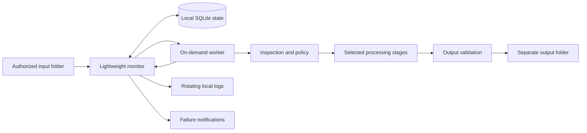
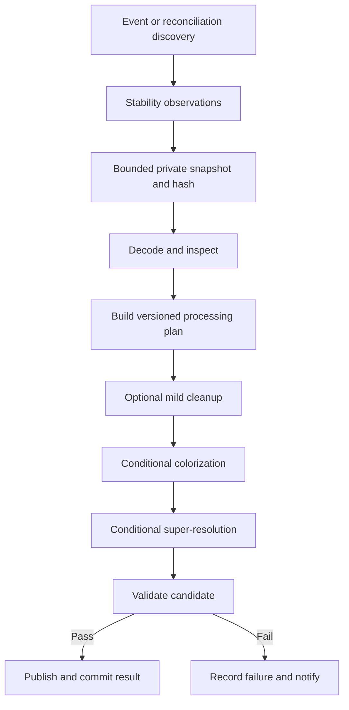

# Local Photo Restoration Engine: Design and Implementation Plan

Saved: 2026-10-21

Status: Planning reference. Saving this document does not approve implementation, dependency installation, model acquisition, autostart registration, or processing actual photographs. Later explicit user instructions supersede this reference.

## Subsequent user clarifications

- Implementation was authorized after this plan was saved.
- The product targets a broad range of laptops, not one specific PC. Machine-specific
  specifications are not a prerequisite for continued development. Windows remains
  the first supported platform; other operating systems remain future work.
- CPU inference is the compatibility baseline. Future hardware detection must choose
  conservative resource settings and enable only qualified acceleration backends.
  Minimum requirements and performance claims must follow measurements across a
  representative laptop matrix, including CPU-only and integrated-GPU systems.
- Use `E:/Revive/test_photos` as the current development input. This path is local
  configuration, not a product default. Keep test photographs out of version control.
- Qualify model compatibility and licenses independently of the development machine;
  benchmark representative hardware before declaring production support.

These clarifications override machine-specific assumptions in the original plan.

## 1. Requirements, feasibility, and chosen defaults

Build a Windows background application that monitors one authorized folder, safely snapshots eligible photographs, selectively processes them locally, and publishes validated derivatives in a separate output folder. Originals remain untouched. SQLite records every candidate, attempt, result, and actionable failure.

**User-selected defaults:**

- Personal batches rather than sustained archive processing.
- CPU-first execution; AMD/Intel acceleration is a later compatibility exercise.
- Run under the normal Windows account.
- Automatically colorize confidently identified grayscale or sepia photos.
- Disable generative face restoration and scratch reconstruction by default.
- Produce lossless 8-bit sRGB PNG derivatives.
- Upscale by at most 2× toward a 4096-pixel long edge; never shrink larger originals.

**Feasibility:** reliable unattended automation is achievable. Consistent aesthetic improvement is less certain. Severe damage, tiny faces, ambiguous colors, and missing detail cannot be reliably resolved without human judgment. CPU inference is feasible in principle, but acceptable processing time and memory use must be measured on the target machine.

**Verified versus unverified:**

| Established | Still unverified |
|---|---|
| Workspace is a greenfield repository | Exact Windows version, CPU, RAM, GPU, and drivers |
| Selected operating defaults above | Typical and maximum scan dimensions |
| Official model repositories provide local inference implementations | Compatibility of the complete selected dependency set |
| DeOldify is archived | Target-machine latency, RAM use, and visual quality |
| Application path checks do not provide OS confinement | Exact checkpoint redistribution rights |

At the time of planning, no dependencies, weights, application files, scheduled tasks, or Drive settings had been changed.

## 2. Architecture, storage access, and deployment

### Recommended components

Use two processes with one active image job:



The monitor owns queue transitions, retries, publication, and notifications. It never imports PyTorch or loads image models. The worker receives one job at a time over inherited process pipes and returns structured progress, results, or errors.

Start a worker only when processing is required. Reuse it briefly for a batch, then terminate after 30 seconds without work. Process exit releases framework allocations more predictably than attempting to unload every model in a persistent process.

### Windows execution choice

| Option | Assessment |
|---|---|
| **Task Scheduler with windowless Python launcher** | Recommended: login trigger, restart policy, normal user session, straightforward uninstall |
| Windows service | Appropriate for operation before login, but complicates synced-folder credentials, installation, and interactive notifications |
| Startup-folder or registry launcher | Simple autostart, but needs additional supervision for crash recovery |
| Unsupervised Python background process | Useful during development; insufficient production lifecycle management |

Task Scheduler supports login and system-event triggers. Configure one instance, no routine execution time limit, no elevation, and restart on failure. A periodic scheduler trigger checks that the monitor is running; an explicit stop command also disables those restart triggers. [Microsoft Task Scheduler](https://learn.microsoft.com/en-us/windows/win32/taskschd/task-scheduler-start-page)

Use a Windows Job Object to contain the worker and terminate it if the monitor exits. Sleep does not count toward worker timeout calculations; reconcile folders and outstanding jobs after resume.

### Folder modes and actual access boundaries

| Concern | Mode A: local/synced folder | Mode B: direct Drive API |
|---|---|---|
| MVP complexity | Low | OAuth, tokens, pagination, change tracking, downloads |
| Normal operation | Local events plus reconciliation | Network-dependent discovery and download |
| Performance | Efficient for resident files | API latency and transfer overhead |
| Reliability concerns | Placeholders, delayed synchronization, event loss | Expired tokens, quotas, outages, change-token recovery |
| Authorization | Application boundaries; optional Windows ACL isolation | OAuth scopes plus account and file permissions |
| Recommendation | **MVP** | Deferred |

The normal-account choice provides **application-enforced restrictions only**. The process retains the account’s other permissions. A later dedicated-account deployment can use ACLs to grant input read access and output/application write access, but requires separate synchronization and notification planning.

Path security:

- Require absolute roots and reject overlapping input, output, and application-data directories.
- Default to local fixed disks; network shares remain unsupported until separately tested.
- Reject traversal, alternate data streams, device paths, and link-based escapes.
- Validate canonical boundaries and final opened-handle paths; string-prefix checks are insufficient.
- Reject symlinks, junctions, and mount-point traversal. Treat cloud placeholders separately rather than rejecting every reparse point: Windows uses reparse points for multiple purposes. [Microsoft reparse points](https://learn.microsoft.com/en-us/windows/win32/fileio/reparse-points)
- Apply equivalent checks to output parent directories before publication.
- Never open source images for writing.

For Google Drive Desktop, require the selected input folder to be available offline. The application itself performs no photograph uploads, but the sync client may independently transfer files.

For a future Drive integration, `drive.file` grants access to explicitly shared/selected files; do not assume selecting a folder grants unattended access to every present and future descendant. Broad read scopes are not confined by a folder-ID filter. Prefer a separate identity with access only to the shared input folder, subject to organizational policy; store tokens using Windows credential protection. [Google Drive scopes](https://developers.google.com/workspace/drive/api/guides/api-specific-auth)

### Technology and installation

- Python 3.11 x64, isolated virtual environments.
- Standard-library TOML parsing, SQLite, structured logging.
- `watchdog` for filesystem events.
- Pillow with LittleCMS support for decoding, orientation, profiles, and encoding.
- NumPy and headless OpenCV for lightweight inspection and conventional cleanup.
- Native PyTorch CPU inference initially.
- `pywin32` for process containment and necessary Windows integration.
- Windows toast adapter with registered application identity; no tray or HTTP server.

Python 3.11 is a compatibility starting point, not a claim that the full stack has been validated. Pin exact dependencies only after fresh Windows installation and inference tests. Current PyTorch installation guidance supports Windows CPU installations; use its official package source. [PyTorch installation](https://pytorch.org/get-started/locally/)

Ship a versioned application directory and environment before attempting a single executable. Later evaluate a directory-based executable bundle; keep weights external. A self-extracting executable adds startup, antivirus, and large-dependency complications without helping inference.

## 3. Model selection and image-processing policy

### Candidate comparison

The resource assessments below are architectural estimates, not measured benchmarks. Exact checkpoint bytes, peak RAM, initialization time, and throughput must be recorded during qualification.

| Candidate | Role and fidelity concerns | CPU/Windows and resource implications | License and maintenance assessment | Decision |
|---|---|---|---|---|
| **DDColor Tiny** | Automatic colorization; plausible colors can still bleed or be incorrect | PyTorch CPU candidate; smaller variant reduces deployment burden relative to larger variants | Apache-2.0 code; verify exact checkpoint terms and current compatibility | Primary colorizer |
| DDColor larger variants | Potential quality improvement; needs blind comparison | More demanding; no assumed CPU speed | Same checkpoint-specific audit | Benchmark alternative |
| DeOldify | Established colorization; possible saturation and legacy dependencies | Older fastai/PyTorch stack raises integration cost | MIT code; archived October 2024; audit weights separately | Comparison baseline only |
| BigColor | Generative color prior; multiple plausible outputs | Additional model/dependency complexity | MIT code; inherited checkpoints require separate review | Research alternative |
| **SwinIR lightweight classical SR** | Reconstruction-oriented alternative; still cannot recover authentic lost detail | CPU-compatible candidate; tiled inference needs seam tests | Apache-2.0 code; verify chosen weights and revision | Strict-preset AI upscaler |
| Real-ESRGAN | Strong perceptual enhancement; may invent texture or sharpen lettering | CPU path and tiled inference available; potentially slow | BSD-3-Clause code; audit checkpoint terms and dependencies | Optional restoration preset |
| Restormer | Learned denoising/deblurring; degradation mismatch can remove detail | Additional model and memory cost | Apache-2.0 repository; checkpoint audit required | Deferred |
| GFPGAN | Face enhancement can change identity-related features | Face detection/alignment and additional models required | Apache-2.0 code; component and weight audits required | Optional later module |
| CodeFormer | Explicit quality/fidelity control does not guarantee identity | Additional face stack; CPU throughput must be measured | NTU S-Lab License 1.0; requires specific use/distribution review | Comparison candidate |
| Bringing Old Photos Back to Life | Targets structured damage; may reconstruct meaningful content | Official setup targets Ubuntu/NVIDIA and includes older components | MIT code; inspect all dependencies and weights | Excluded from MVP |

Sources: [DDColor and model zoo](https://github.com/piddnad/DDColor), [DeOldify](https://github.com/jantic/DeOldify), [BigColor](https://github.com/KIMGEONUNG/BigColor), [SwinIR](https://github.com/JingyunLiang/SwinIR), [Real-ESRGAN](https://github.com/xinntao/Real-ESRGAN), [Restormer](https://github.com/swz30/Restormer), [GFPGAN](https://github.com/TencentARC/GFPGAN), [CodeFormer](https://github.com/sczhou/CodeFormer), [Microsoft old-photo restoration](https://github.com/microsoft/Bringing-Old-Photos-Back-to-Life).

DDColor is newer than DeOldify, but publication age and repository availability do not establish active maintenance. Qualification must record recent relevant commits, unresolved installation defects, release history, and the application’s tested revision. No candidate receives an “actively maintained” guarantee from this initial review.

Newer systems are not automatically better fits: ColorMNet, for example, focuses on video color propagation and adds capabilities this still-image MVP does not need. [Official ColorMNet repository](https://github.com/yyang181/colormnet)

**Fallback:** conventional cleanup and unchanged-resolution output remain available if an optional upscaler fails qualification. A requested colorization job must report failure if its colorizer is unavailable; silently producing an uncolorized “successful colorization” is prohibited.

### Processing sequence



1. **Safe decoding:** identify actual format, verify and fully decode the snapshot, apply EXIF orientation once, and retain original metadata separately.
2. **Inspection:** dimensions, frames, bit depth, alpha, ICC profile, grayscale/sepia evidence, blur/noise indicators, clipping, and compression artifacts. Metrics guide decisions; they do not prove degradation.
3. **Policy:** produce an explicit list of enabled stages and reasons for skipping others.
4. **Cleanup:** conservative denoising and tonal adjustment only when evidence passes calibrated thresholds. Avoid default local contrast enhancement or sharpening.
5. **Colorization:** infer chroma from a bounded-resolution whole-image view and combine it with preserved luminance at working resolution. Avoid independent colorization tiles because their colors can disagree.
6. **Resolution:** use native 2× inference where available, then resize to the requested target. Default scale is `min(2, max(1, 4096 / long_edge))`. Larger originals retain their dimensions.
7. **Final conversion:** valid sRGB profile, controlled gamut conversion, lossless PNG encoding, orientation normalized.
8. **Validation and publication:** decode output again, check expected geometry and metadata, assess severe regressions, then publish.

MVP supports single-frame JPEG, PNG, TIFF, BMP, and WebP. Animated/multipage inputs, unsupported high-bit-depth modes, and images exceeding resource limits receive explicit skipped/unsupported states. Transparent images bypass RGB-only AI stages initially; do not flatten them silently.

### Fidelity rules

| Verification level | Rules and treatment |
|---|---|
| Mechanically enforceable | Source read-only behavior, separate intermediates, allowed stage list, no crop/scene extension/object removal, expected dimensions, valid encoding, versioned settings |
| Approximate | Grayscale/sepia detection, excessive smoothing/sharpening, luminance drift, edge preservation, severe artifacts |
| Human judgment required | Identity, apparent age/expression, historical color accuracy, authentic detail, overall aesthetic improvement |

All presets prohibit unrestricted generative fill and composition changes.

- **Conservative color:** default; confident colorization, mild cleanup, reconstruction-oriented SR, no face replacement.
- **Strict fidelity:** colorization and AI SR disabled unless explicitly enabled; conservative conventional processing.
- **Restoration:** optional Real-ESRGAN and stronger bounded cleanup; face processing still requires explicit enablement.

Future facial processing must use detected and aligned sufficiently large faces, conservative blending, and per-face fallback to the original region. Tiny or uncertain detections are skipped. Landmark and embedding comparisons are warning/rejection heuristics, never proof of preserved identity.

## 4. Reliability, interfaces, resources, and configuration

### File readiness and durable state

Use native filesystem events through watchdog, plus a bounded reconciliation scan every five minutes and after startup/resume. Watchdog provides platform-specific observers behind a common API. [Watchdog documentation](https://python-watchdog.readthedocs.io/en/stable/)

Readiness defaults:

- Observe unchanged size and modification time across three samples over at least ten seconds.
- Reset the quiet period on a relevant event.
- Attempt a read handle that denies concurrent writes/deletion where supported.
- Copy to a bounded application working file while hashing.
- Compare source identity and metadata before and after copying; discard and retry if changed.
- Decode only the private snapshot.
- Where exclusive sharing semantics are unavailable, require two matching full-content reads separated by the quiet period.

These reduce risk but cannot prove a paused transfer is complete. A producer-side temporary filename followed by rename is the strongest cooperative completion signal.

Use SQLite locally, outside synced folders, with transactions, WAL, and durable synchronization. JSON state would require custom concurrency, recovery, and atomic-update logic already supplied by SQLite. [SQLite atomic commit](https://www.sqlite.org/atomiccommit.html)

Persist:

- Source observation: relative path, file identity, size, timestamp, snapshot SHA-256.
- Job: source revision, pipeline fingerprint, state, timestamps, retry count.
- Attempt: backend, model digests, stage plan, error, measurements.
- Artifact: intended/final path, checksum, encoding, provenance.
- Incident: suppression key, first/last occurrence, notification history.

States:

`detected → waiting_stability → queued → processing → completed`

Branches: `retry_pending`, `failed`, `skipped`. Every terminal outcome carries a reason.

Deduplicate repeated events by source revision and processing fingerprint. Identical content at different paths retains both source mappings while permitting verified artifact reuse. Changed bytes create a new revision. Configuration/model changes affect new jobs; existing completed jobs require an explicit reprocess command.

### Crash-safe publication

- Preserve subdirectories.
- Name derivatives `<stem>_restored_<source-hash>_<pipeline-hash>.png`.
- Lengthen digest suffixes on a verified collision; never overwrite an unrelated artifact.
- Write and validate a temporary file in the destination directory.
- Persist publication intent and expected checksum.
- Flush and perform a same-volume, no-replace rename.
- Mark completion transactionally afterward.

SQLite and the filesystem do not share a transaction. Startup recovery checks publication intent: adopt a matching artifact, retry missing output, or report a conflicting artifact. Atomic visibility does not guarantee durability on every filesystem or after every hardware failure.

Central SQLite provenance is authoritative. Preserve appropriate descriptive metadata, retain original metadata in state, and embed compact provenance where supported. Offer a manifest export command rather than mandatory sidecars. Record inferred colors explicitly.

### Internal and operational interfaces

- `StorageSource`: discover candidates and obtain safe snapshots.
- `Analyzer`: return inspection evidence.
- `PolicyEngine`: produce a deterministic processing plan.
- `ModelAdapter`: expose capabilities, load, run, and report resources.
- `OutputPublisher`: validate, reserve, publish, recover.
- `Notifier`: deduplicated failure delivery.

Worker messages contain job IDs and validated snapshot references, not arbitrary commands. The monitor alone updates durable job state.

Provide CLI commands for `validate-config`, `doctor`, `run`, `status`, `stop`, `retry`, `reprocess`, `export-manifest`, and autostart installation/removal. Commands require deliberate use; routine operation remains unattended.

### Resource strategy

- One image worker, batch size one.
- CPU FP32; default two inference threads and below-normal process priority.
- Load only the current stage’s model.
- Bound decoder pixels, snapshot bytes, tile dimensions, temporary disk usage, and pending admissions.
- Begin tiled SR at 128-pixel tiles; retry at smaller validated tile sizes after memory pressure.
- Never reduce requested resolution silently to recover an OOM.
- Use a Windows Job Object memory ceiling as crash containment, plus softer admission estimates. It is not a promise that every backend stays within a precise working-set budget.
- Stop admitting new jobs at queue capacity; record the condition and rediscover deferred files through reconciliation.
- Leave GPU unallocated in the CPU baseline.

Later hardware adapters:

| Backend | Qualification requirement |
|---|---|
| NVIDIA CUDA | Supported GPU/driver, matching PyTorch build, FP16 quality checks |
| AMD/Intel DirectML | Valid ONNX export, operator support, output parity, actual performance benefit |
| Intel OpenVINO | Model conversion and precision/resource validation |
| CPU | Guaranteed baseline after qualification |

ONNX Runtime DirectML has provider-specific constraints; it is not a drop-in acceleration guarantee for arbitrary PyTorch models. [DirectML provider documentation](https://onnxruntime.ai/docs/execution-providers/DirectML-ExecutionProvider.html)

### Configuration defaults

Use TOML with strict types, unknown-key rejection, ranges, and configuration versioning.

```toml
schema_version = 1

[paths]
input = "D:/OldPhotos"
output = "D:/RestoredPhotos"
app_data = "%LOCALAPPDATA%/Revive"

[watch]
recursive = true
process_existing = true
formats = ["jpeg", "png", "tiff", "bmp", "webp"]
stable_samples = 3
quiet_seconds = 10
reconcile_seconds = 300

[pipeline]
preset = "conservative_color"
colorization = true
colorizer = "ddcolor_tiny"
face_restoration = false
scratch_removal = false
denoise_strength = 0.15
colorization_strength = 0.85
upscaler = "swinir_lightweight_x2"
max_scale = 2
target_long_edge = 4096
downscale_existing = false

[resources]
backend = "cpu"
workers = 1
cpu_threads = 2
worker_idle_seconds = 30
worker_memory_mib = 4096
max_input_megapixels = 40
max_output_megapixels = 64
max_source_mib = 512
max_pending_jobs = 1000
max_temp_gib = 8
min_free_disk_gib = 5
tile_pixels = 128

[retry]
max_attempts = 4
delays_seconds = [60, 300, 1800]

[notifications]
failures_only = true
max_per_hour = 3
repeat_after_hours = 24

[output]
format = "png"
color_space = "srgb"
preserve_subdirectories = true
```

Numeric processing strengths are adapter-normalized policy settings, not raw model parameters. Unsupported enabled settings fail validation. Resource numbers are provisional safety defaults: `doctor` must reject an unsuitable configuration before unattended use.

### Failures and notifications

| Codes | Behavior |
|---|---|
| `INPUT_UNAVAILABLE`, `OUTPUT_UNAVAILABLE`, `FILE_BUSY` | Retry with backoff; coalesce folder incidents |
| `SOURCE_CHANGED` | Discard snapshot and restart readiness |
| `SOURCE_CORRUPT`, `FORMAT_UNSUPPORTED`, `IMAGE_LIMIT` | Terminal for that revision; explain corrective action |
| `DISK_LOW`, `ACCESS_DENIED` | Pause affected work; retry after recovery |
| `MODEL_MISSING`, `MODEL_HASH_MISMATCH`, `BACKEND_UNSUPPORTED` | Pause dependent jobs; one shared incident |
| `GPU_OOM`, `RAM_LIMIT`, `WORKER_CRASH` | Bounded recovery; smaller validated tiles where applicable |
| `OUTPUT_INVALID`, `QUALITY_REGRESSION` | Do not publish success |
| `STATE_CORRUPT`, `PUBLISH_CONFLICT` | Fail closed and preserve evidence |

Notify on permanent failure, exhausted retries, or shared conditions requiring intervention. Include basename or neutral job ID, cause, retry status, and corrective action. Exclude full paths, image previews, and credentials.

Use registered Windows application identity for toasts. OS notification settings can suppress delivery; retain incidents in state and logs and provide a notification test. [Microsoft desktop toast identity](https://learn.microsoft.com/en-us/windows/win32/shell/enable-desktop-toast-with-appusermodelid)

## 5. Implementation roadmap and production acceptance

### Repository and runtime separation

```text
pyproject.toml
src/revive/
  cli.py
  config/
  monitor/
  storage/
  state/
  pipeline/
  models/
  resources/
  output/
  notifications/
tests/
  unit/
  integration/
  e2e/
  fixtures/
configs/
scripts/
docs/
requirements/
```

Application data contains configuration, state, logs, weights, and temporary snapshots. User photographs and outputs remain outside the repository. Never commit private test photos or model weights.

### Phased deliverables

| Phase | Tasks and dependencies | Deliverables and acceptance | Main risk |
|---|---|---|---|
| **1. Qualification** | Inventory hardware; audit licenses; test fresh CPU environment and model adapters after approval | Requirements, threat model, model matrix, exact weight sizes/digests, locked environment, benchmark report | Dependency conflicts or unacceptable CPU latency |
| **2. Automation MVP** | Path checks, watcher, stability, SQLite, mock worker, publication recovery | All discovery/deduplication/crash tests pass; no source writes | Sync and filesystem edge cases |
| **3. Conventional processing** | Decode, orientation, profiles, inspection, mild cleanup | Valid derivatives; geometry/profile/metadata fixtures pass | Grain loss and bit-depth surprises |
| **4. Colorization** | DDColor Tiny adapter, grayscale/sepia calibration, luminance-preserving integration | Blind sample review; uncertain/already-color images bypass recolorization | Wrong colors and color bleeding |
| **5. Super-resolution** | SwinIR 2× adapter, bounded tiles, output sizing; compare Real-ESRGAN | Correct dimensions; seam and memory tests pass | Slow CPU inference and texture invention |
| **6. Optional faces** | Separate adapter qualification and explicit enablement | Remains disabled until identity/artifact review passes | Hallucinated facial features |
| **7. Background operation** | Windowless launch, Task Scheduler, single-instance lock, Job Object, stop/restart | Login, crash, restart, sleep/wake tests pass | Hidden startup failures |
| **8. Failure hardening** | Error taxonomy, retries, notification registration, rate limiting, recovery | Fault injection produces actionable, deduplicated incidents | Alert suppression or retry storms |
| **9. Optimization** | Measure and tune threads, model lifetime, tiles, limits | Target-PC responsiveness and idle gates pass | Optimizing at quality’s expense |
| **10. Release** | Reproducible package, offline model import, documentation, uninstall | Clean-machine install, offline run, upgrade recovery and uninstall pass | Packaging/runtime drift |

Reliability features begin in Phase 2; Phase 8 hardens them rather than introducing them late.

Model acquisition is an explicit setup operation using official upstream sources. Maintain a registry of source revision, URL, digest, architecture, license evidence, and tested backend. A locally recorded digest proves subsequent integrity, not original authenticity. Runtime never downloads weights automatically.

Use dependency hashes, security auditing, an inventory/SBOM, and separate CPU/GPU locks. If an adapter needs minor compatibility changes, maintain a small licensed patch; avoid importing an entire obsolete research environment into the monitor.

### Automation test scenarios

| Scenario | Expected result |
|---|---|
| Empty folder startup | Monitor remains idle; no worker |
| Single arrival | One stable snapshot and one output |
| Simultaneous arrivals | Durable bounded queue; one worker |
| Slow copy | No processing while writes continue |
| Synced arrival | Resident stable content processed; unavailable placeholder deferred |
| Duplicate event | No duplicate job |
| Same bytes added twice | Both source mappings retained; verified result reuse allowed |
| Updated source | New revision; previous output retained |
| Corrupt image | Explicit terminal failure; no output |
| Full output disk | No final partial file; retry after recovery |
| GPU OOM | Injected adapter test; bounded tile recovery or explicit failure |
| Sleep during processing | Resume without false timeout; reconcile |
| Worker/monitor crash | Recover lease and publication intent |
| PC restart | Login startup and durable reconciliation |
| Missing input folder | Shared incident; resume after return |
| Missing output folder | Preserve queue; resume safely |
| Spaces/Unicode/long paths | Correct mapping or explicit supported-limit error |
| Missing weights | Pause affected jobs; one actionable incident |
| Already-color photo | Colorizer bypassed |
| Preset change | New jobs use new fingerprint; old results remain |

Also test junction/symlink swaps, output-path replacement, duplicate process launch, queue saturation, source changes during snapshotting, database faults, missing completed artifacts, and crashes immediately before/after final rename.

### Quality and performance evaluation

Create a consented local corpus of at least 30 photographs covering clean monochrome portraits, severe damage, small group faces, sepia, modern color, landscapes, large scans, partial corruption, transparency, and significant text.

Measure wall time, initialization time, peak RAM/VRAM, CPU use, output bytes, retries, and failure rate. Use synthetic degradation with known references for PSNR/SSIM; use edge/luminance comparisons as regression checks. No-reference metrics and identity embeddings are supporting evidence only.

Proposed release gates, **not measured results**:

- Source hashes unchanged across every test.
- No duplicate publication or silent loss in repeated fault-injection runs.
- All published images fully decode and meet planned geometry.
- Zero worker processes and zero application GPU allocations after the idle timeout.
- Target idle monitor RSS below 100 MiB and average CPU below 0.5% over 15 minutes; measure reconciliation separately.
- Seven-day unattended soak without unexplained job loss or notification storms.
- Human review finds no severe identity, composition, text, or artifact regression in released default outputs.
- CPU processing times are reported by image class; no production speed promise until target-machine measurements exist.

### Approval boundaries and final MVP

Approval of the design would authorize implementation of Mode A monitoring, durable state, safe outputs, conservative cleanup, automatic confident colorization, bounded 2× enhancement, failure alerts, and login startup.

Separate approval remains required before installing dependencies, acquiring weights, registering autostart, or processing the actual photo collection, as requested in the original brief. Face restoration, scratch reconstruction, direct Drive integration, and broader access isolation remain later features. Later explicit authorization can cover these actions without repeated permission requests.

The initial production release is gated on exact checkpoint licensing, reproducible Windows CPU installation, measured resource safety, and reviewed representative outputs. It must describe its results as AI-restored derivatives with inferred colors, never authenticated historical reconstructions.
